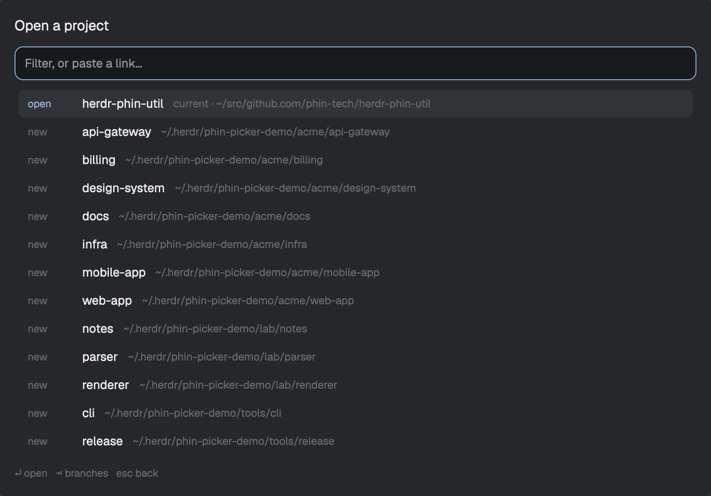

# Phin Picker

Get to a repo, a branch, a PR or a Linear ticket in one keystroke, in the
[Herdr](https://herdr.dev) desktop app. A JavaScript mod ported from the picker
in [herdr-phin-util](https://github.com/phin-tech/herdr-phin-util), which stays
the plugin for terminal Herdr.



Needs `git`, and `gh` authenticated for PRs, issues and cloning.

## Install

Paste this to your coding agent:

```
Read ~/.config/herdr-app/AGENTS.md, then add this mod: https://github.com/phin-tech/herdr-phin-picker
```

The agent is the installer, since the app has no install command. It reads the
files, adds both mods and merges the keys, asking before it replaces a key you
already use.

Or run the installer, which also updates:

```sh
curl -fsSL https://raw.githubusercontent.com/phin-tech/herdr-phin-picker/main/install.sh | sh
```

It shows what it will do, asks before changing anything, and walks through four
steps: download, back up any old copy, install, and add the keys. It installs a fixed
release and checks its SHA-256, so it never runs whatever happens to be on `main`. It
keeps any key you already use, and tells you if that happens. Without `jq` it prints
the keys for you to add. Use `sh install.sh --yes` to skip the questions.

To work on it, clone the repo and symlink the two folders from `mods/` in instead.
The installer refuses to run over those symlinks, so update your clone instead.

| Key | Does |
| --- | --- |
| `cmd-o` | open the picker on your projects |
| `cmd-shift-o` | open it on the branches of the repo in focus |

## Using it

Open Spaces come first, then checkouts on disk, each with the repos you use most
and most recently at the top. A checkout with a Space never appears twice.

| Key | Does |
| --- | --- |
| type | subsequence filter over name and path |
| `enter` | open the row, with no agent unless `agent.enabled` is set |
| `tab` | on a repo, its worktrees and branches; on anything else, what to do with it |
| `shift+tab` / `esc` | back up a level, filter intact |
| `ctrl+r` | fetch and refresh, at the branch level |

Paste into the box instead of filtering:

| Pasted | You get |
| --- | --- |
| GitHub PR URL | a worktree Space on the PR's branch, `pr-N` for a fork |
| GitHub issue URL | a worktree Space on a branch named from the title |
| Linear URL | pick a repository, then a base, for the ticket's branch |
| `owner/repo#42` | the same as pasting that PR or issue |
| `owner/repo` or a repo URL | clone it, or open it if you have it |

A PR or issue link for a repo you don't have clones it first. From a PR row, `tab`
offers the whole stack, when there is one: one Space with a tab per layer, focused
on the PR you pasted. It finds stacks made with `gh stack`, which it doesn't need
installed, and ones built with plain git. Where a stack forks, each chain gets its
own row.

Reopening a PR fast-forwards its worktree. If it has local commits or uncommitted
changes it's left alone, and a toast and the agent's prompt both say it's behind.

To browse a GitHub org or user, type `org:acme` or `acme/` and press `enter` on the
Search row. `org:` lists your account and orgs as you type, so `org:ph` narrows them
and arrows pick one. No repos are read until you pick. The list is saved for a day, and `ctrl+r`
refreshes it. Repos you have show as usual, and the rest can be cloned. Names in
`orgs` get a Search row at the bottom of your projects.

Type a name that matches no branch and you get a row that creates it, based on
the default branch.

The `tab` level offers Open and a Start row for each agent installed here. Type
in the box there to give the agent a prompt, replacing the configured one, or
press `tab` on a Start row to pick a saved prompt.
Projects and branches have no configured prompt by default. Agent prompts are
sent as soon as the agent starts. The app has no way to type
one and leave it unsent.

## Configuration

The `tab` level lists the agents Herdr knows are installed. Add others with `agents`
in `config.json`, as a command or path, or as a list with its flags. The name is the
Start row's label:

```json
{ "agents": { "omp": "~/.bun/bin/omp", "fast claude": ["claude", "--model", "sonnet"] } }
```

Each one is checked when the level opens, so an agent missing on this machine just
isn't offered, and one config works across machines. An entry for a program Herdr
already knows replaces its row.

Everything lives in `~/.config/phin-tech/picker/`. `config.json` is optional, and
so is every key in it:

```json
{
  "repos": { "templates": ["~/src/{host}/{owner}/{repo}"] },
  "orgs": ["acme"],
  "agent": {
    "enabled": false,
    "argv": ["claude"],
    "prompts": {
      "github_pr": "Review PR #{{.Number}} — {{.Title}}\n{{.URL}}",
      "github_issue": "Work issue #{{.Number}} — {{.Title}}\n{{.URL}}",
      "linear": "Work {{.Issue}} — {{.Title}}\n{{.URL}}",
      "project": ""
    }
  },
  "projects": { "roots": ["~/src/*/*"], "git_only": true, "depth": 1 },
  "worktrees": { "path": "~/.herdr/worktrees/{repo}/{branch}" }
}
```

`projects.roots` defaults to what `repos.templates` implies. Roots must be inside
your home folder, since mods can't read outside it. Prompts take plain
`{{.Field}}` placeholders: `URL Host Owner Repo Number Title Issue Slug Branch
Text Path`.

## Saved prompts

`tab` on a Start row lists the prompts that suit that row:

| Row | Prompts |
| --- | --- |
| project or branch | `orient`, `plan`, `fix-tests`, `review-branch` |
| PR | `orient`, `review`, `address-comments`, `fix-ci` |
| issue or Linear ticket | `orient`, `plan`, `implement`, `investigate` |

Add your own, or replace one of these by using its name. Each `.md` or `.txt` file in `~/.config/phin-tech/picker/prompts/` is a prompt,
named after the file, and shows on every row:

```
~/.config/phin-tech/picker/prompts/
  review.md      Review {{.Branch}} for correctness bugs.
  plan.md        Read {{.Repo}} and write a plan before changing anything.
```

They take the same placeholders as the prompts above. A row only fills in what
it knows: a PR has `Number`, `Title` and `URL`, while a branch has `Repo`, `Path`
and `Branch`. Anything else renders empty. The picker reads the folder each time,
so a new file shows up without a reload.

## Updating

Run the installer again. It backs up your old copy, and your settings and saved
prompts stay put. Each version is a fixed release, and the Changelog in `RECIPE.md`
says what changed and anything you need to do by hand. To have your agent do it,
paste the install line above.

## Uninstalling

```sh
curl -fsSL https://raw.githubusercontent.com/phin-tech/herdr-phin-picker/main/uninstall.sh | sh
```

It asks first, then moves both mods to a backup folder and removes only the keys
that open them. Your settings and saved prompts stay in
`~/.config/phin-tech/picker/`, so delete that folder too if you want them gone.

## Security

Mods aren't reviewed by Herdr, so here's what this one does:

- It runs `git`, `gh`, `hc` and `herdr-app` as you, using your own GitHub login.
- It clones repos, makes worktrees and starts your coding agents when you ask.
- It reaches the network only through `git` and `gh`, and sends nothing anywhere else.
- It reads inside your home folder, and writes settings only to Herdr's own state.

**Treat a PR as untrusted input.** Its title goes into the agent's prompt, and the
agent then reads its description and code, all of which a stranger can write,
including instructions aimed at your agent. Be especially careful with PRs from
forks, and with prompts that run code, like `fix-ci`. A prompt saying "don't change
anything" is only a request: use your agent's read-only mode when it matters.

## Debugging

If the picker hangs or misbehaves, add `"debug": true` to `config.json` and reopen
it. The footer then says `debug log on`, and `~/.config/phin-tech/picker/debug.log`
records every key that moves you around, command, step and timing. A line reading
`start` with nothing after it is what it was stuck on, and `STALLED` means the picker's
own code blocked for a moment.

The log stays on your machine, only you can read it, and it stops at 1 MB. It holds no
prompts or typed text, but it does name your repos, branches, folders and agents, and
any error text from `git` or `gh`, so read it before sharing it. Remove the setting
when you're done.

## Issues and contributing

Report problems on [GitHub issues](https://github.com/phin-tech/herdr-phin-picker/issues).
The GitHub repo is a read-only copy of the Forgejo source at
[git.phin.tech](https://git.phin.tech/sam/herdr-phin-picker), so pull requests are off.

## Hacking on it

`AGENTS.md` has how to change and test this, for agents and people alike.
