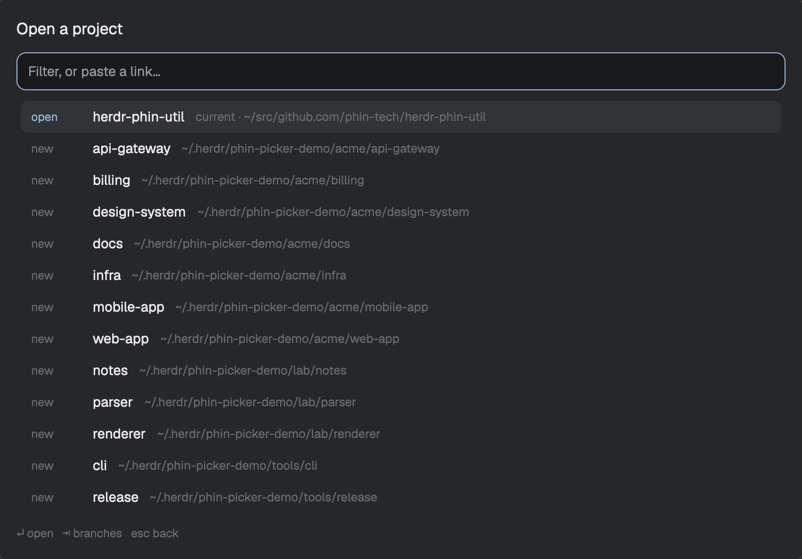

# Phin Picker

A keyboard picker for getting to work: press a key, type a few letters or paste a
link, and land in the right repo, branch, pull request or ticket as a Herdr Space.
It clones, fetches, makes worktrees and starts agents on the way there, and it can
open a whole stack of pull requests as one Space with a tab per layer.

## What you see

A 760px wide popup, 40px below the top of the window and 70% of its height, on the
theme's `popover` color with 16px padding and 13px text. Top to bottom:

- **Title**, 15px semibold: `Open a project`, then `› name` for each level entered.
- **Ticket line**, 12px in `accent`, only while a Linear ticket waits for a home.
- **Input**, 36px tall, rounded 9px, 1px `accent` border on `background`.
- **Rows**, 30px tall, rounded 7px, 14 at most in a window that follows the cursor.
  Each has a 48px badge in 11px `dim` (`accent` for `open`), the label in
  `foreground` truncated at 280px, and a detail in 11.5px `dim`.
- **Warning**, 11.5px in `blocked`, prefixed `⚠`, when something is wrong.
- **Footer**, 11px `dim`: what `enter` and `tab` do on this row.

Badges: `open` a Space, `new` a checkout with no Space, `clone`, `link`, `tree` a
worktree, `local` and `remote` branches, `create` a new branch, `base` a ticket's
starting point, `gone` a worktree missing on disk, `do` an action, `prompt`, `stack`, `org`.

While work runs the rows give way to a checklist, one 26px line per step: `◐` in
`working`, `✓` in `done` with seconds taken, `✕` in `blocked`, with the reason in
the warning line.

## How it behaves

Agent statuses aren't shown: it opens agents and leaves watching them to the agents
list. An open agent's Space shows up as an `open` row like any other.

- **Lists:** open Spaces first with the current one last, then checkouts with no
  Space. Each group has the repos used most and most recently on top. A checkout
  with a Space never appears twice.
- **Typing** filters by subsequence over name, then detail. `up` and `down` move.
- **`enter`** opens the row with no agent, unless `agent.enabled` is set.
- **`tab`** goes deeper: on a repo, its worktrees and branches; on any other row, an
  action level with Open, a Start row per installed agent (Herdr's, plus any in the
  config's `agents` found on this machine), and on a pull request in a stack, Whole
  stack. Typing at the action level is a prompt for the agent. `tab`
  on a Start row lists saved prompts.
- **`shift-tab` and `esc`** go back with the filter intact, or close at the top.
  `esc` during a job ends it.
- **`ctrl-r`** fetches at the branch level.
- **Pasted text** replaces the list with one row: a GitHub PR, issue or repo URL
  with or without `https://`, `owner/repo`, `owner/repo#42`, or a Linear URL. An
  open Space for it is offered instead. A missing repo is cloned first.
- **`org:`** lists you and your orgs at once, and `org:ph` narrows them, with a row
  for any other name. Arrows move, and `tab` or `enter` goes in.
- **`org:name` or `name/`** offers one `org` row, and nothing is fetched until it's
  picked. Its repos then list newest push first, as `open`, `new` or `clone`, saved
  for a day in shared state `phin-picker.orgs`. `ctrl-r` refreshes.
- **A name no branch has** at the branch level becomes a `create` row, based on the
  default branch.
- **Clicks** on a row act like `enter`.
- **`cmd-shift-o`** opens straight on the branches of the repo in focus.

## Built from

Two mods, no layout. Both have `{ "place": "none" }` and the overlay above in
`mod.json`. They open with `mod.open` from `keys.json`.

- `phin-picker`: `main.js` is the UI. `target.js` parses links, `rows.js` builds and
  ranks rows, `config.js` reads settings, `stack.js` finds stacks, `recent.js` scores
  use, `prompts.js` holds built-in prompts. `lookup.js` and `actions.js` do the work,
  taking the outside world as an argument.
- `phin-worktrees`: only closes itself and opens `phin-picker` with props
  `{ start: "branches" }`.

From `herdr`: `spaces`, `panes`, `focused`, `run`, `exec`, `hc`, `home`,
`knownAgents`, `readTextFile`, `notify`, `shared`, `setShared`, `props`,
`closeOverlay`, `theme`. From `fs/promises`: `exists`, `readdir`. Commands:
`space.new`, `space.select`, `tab.new`, `tab.select`, through `run` or
`herdr-app do`. Programs: `git`, `gh`, `hc`, `herdr-app`, `mkdir`, `env`.

Settings are `~/.config/phin-tech/picker/config.json`, saved prompts are `.md` or
`.txt` files in `prompts/` beside it, use scores are shared state
`phin-picker.recent`, and the last project list is `phin-picker.paths`. It reaches the network through `git` and `gh` only.

## Watch out

- Herdr kills mod code that runs about a second without yielding, and QuickJS is 10
  to 30 times slower than Node. Keep loops linear on large lists.
- `exec` stops at 30 seconds, so clones, fetches and `git worktree add` run in a
  core terminal with `hc run --bg`, and `hc wait` in a loop. It carries no
  `herdr.*` labels, so it stays off screen, and `GIT_TERMINAL_PROMPT=0` so it can't
  wait on a prompt nobody sees.
- `fs/promises` only reads inside home, and `exists` throws outside it. Start glob
  walks at the deepest literal folder, and cap `**`, since symlinks can loop.
- A mod can't import from a sibling folder, and `mod.open` passes no props, which
  is why `phin-worktrees` exists.
- The input takes `ctrl-a` and similar keys, so choices are rows on tab levels.
- `task` reaches the agent as a plain argument and submits at once. A leading `-`
  would read as a flag, so a space goes in front. A prompt can't be typed unsent.
- `run()` answers nothing. A stack needs ids, so it uses `herdr-app do`.
- `gh stack view` denies any stack it didn't make, so read `pullRequest.stack` over
  GraphQL, then walk `baseRefName` across open PRs. Skip fork heads in that walk: a
  fork's `main` isn't the parent of what's based on `main` here.
- A fork's branch isn't on `origin`, and a merged PR's may be deleted. Fetch
  `refs/pull/<n>/head`, onto branch `pr-<n>` for a fork.
- Reopening a PR only fast-forwards, and warns instead when there are local commits
  or uncommitted changes.
- Checkouts must be inside home, and it works on this machine only.
- It assumes `git`, an authenticated `gh`, and checkouts laid out like
  `~/src/{host}/{owner}/{repo}` unless `repos.templates` says otherwise.

## Done when

- `herdr-app check` passes on both mods, and `npm test` passes.
- `cmd-o` lists open Spaces, then checkouts, and typing narrows them.
- Pasting a GitHub PR URL offers one row, and `enter` opens a Space named `repo#N` on
  a worktree at the PR's head commit.
- Pasting it again offers `open`, and reopening after new commits catches up.
- `tab` on a PR in a stack offers Whole stack, which opens one Space with tabs
  `L1 #n`, `L2 #n` and the pasted PR focused.
- `tab` on a Start row lists prompts, and picking one starts that agent with it.

## Updating

An installed copy's version is `version` in `mods/phin-picker/mod.json`. No version
means a new install: copy both mods in, merge `keys.json`, and skip the Changelog.
Otherwise:

1. Read the Changelog below for every version newer than the installed one, and
   tell the person what changes, especially anything under **You need to**.
2. Replace `mods/phin-picker/` and `mods/phin-worktrees/` with this repo's. If the
   person edited them, keep their version aside first, as a mod with a new name.
3. Do what **You need to** says. Settings and saved prompts live in
   `~/.config/phin-tech/picker/`, so a replace leaves them alone.
4. Done when `herdr-app check` passes on both mods.

## Changelog

Newest first. Each version is one that was pushed.

### 0.4.1 (2026-10-30)

- Fixes `tab` freezing on PRs in repos where branches merge into each other. Herdr
  stops mod code after about a second, which left the popup stuck.
- `tab` shows what it's doing instead of a blank list.
- The picker opens instantly from its last list and refreshes behind it, reads your
  agents and top repos ahead of `tab`, and filters long branch lists faster.

### 0.4.0 (2026-10-30)

- `org:name` or `name/` lists a GitHub org's or user's repos, only when picked, and
  saves the list for a day. `orgs` in the config adds a permanent Search row, and
  `org:` completes against you and the orgs you belong to.
- `agents` in the config adds agents by command or path. Each is offered only on a
  machine that has it.

### 0.3.0 (2026-10-30)

- Whole stack: `tab` on a PR in a stack opens one Space with a tab per layer.
- `owner/repo#42` works, and a link to a repo you don't have clones it first.
- Repos rank by how often and how recently you use them.
- Reopening a PR fast-forwards its worktree, or warns if there's local work.
- Fork PRs open on `pr-N`, and merged PRs with deleted branches still open.
- Bad config no longer blanks the picker. Long jobs have a 15 minute limit.

### 0.2.0 (2026-10-30)

- `enter` opens with no agent, and `tab` offers what to do: Open, a Start row per
  agent, a typed prompt, or a saved prompt. `ctrl+a` is gone.
- Built-in prompts, and your own in `~/.config/phin-tech/picker/prompts/`.

**You need to:** move `~/.config/phin-picker/config.json` to
`~/.config/phin-tech/picker/config.json` if it exists, and set `agent.enabled` to
true to keep `enter` starting an agent.

### 0.1.0 (2026-10-30)

- First version: repos, worktrees and branches, PR, issue and Linear links, and
  cloning.
